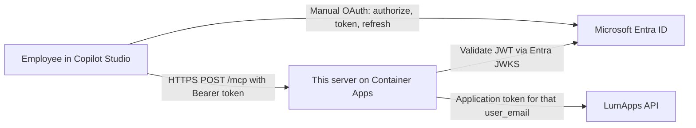

# LumApps MCP Server

Wheatfield Studio server that exposes a LumApps intranet to Microsoft Copilot Studio over the Model Context Protocol (MCP). Copilot Studio calls this process. This process calls LumApps as the employee who signed in with Microsoft Entra ID.

This project is not affiliated with or endorsed by LumApps.

The client this deployment is built for is Copilot Studio on **Streamable HTTP** `POST` and `GET /mcp`. Azure Container Apps is the hosting path. The step-by-step setup is [docs/deploy-azure.md](docs/deploy-azure.md).

## What it does

An employee asks Copilot a question. Copilot calls a tool on this server (`search_content`, `get_content_body`, and the others listed below). The server checks the Entra access token, then asks LumApps for data **as that employee** and returns the text to Copilot.

The server does not store intranet content. It does not collect passwords. Entra is the authorization server. This process only validates access tokens and publishes the metadata Copilot Studio reads.

## Architecture



| Piece | Role |
| --- | --- |
| Copilot Studio | MCP client. Use the **Manual** OAuth wizard. |
| Entra ID | Issues the access token. Runs PKCE. There is no registration endpoint on this server. |
| This process | FastAPI on port 8000. MCP at `/mcp`. Probes at `/health` and `/ready`. |
| LumApps | Content system. The server holds a LumApps **application** credential and exchanges it, plus the email from the Entra token, for a short-lived user token. |

That LumApps call is application impersonation (`grant_type=client_credentials` with `user_email`). It is not the employee's interactive LumApps login. The email must come from the Entra token. A caller cannot supply a different email.

## Trust boundaries

1. **Entra and Copilot Studio.** Entra authenticates the employee. Copilot holds the client secret for the app registration it uses to talk to Entra. This server never sees that client secret and never sees the employee's password.
2. **This process.** It sees the Entra access token, the employee's email, the LumApps payload for the request, and the LumApps application secrets in environment variables. Tokens are cached in memory for their lifetime. Nothing is written to a database or to disk.
3. **LumApps.** Content, directory data, and site design live in LumApps. A read tool uses the read application (`all.read`). A content or structural tool uses the admin application (`all.admin`) and is still checked against that employee's LumApps permissions.

An API key on this server is a **session** credential for `initialize` and `tools/list`. It is not an employee. `tools/call` with only an API key is rejected, so the key cannot choose whose LumApps data is read.

## Authentication

`AUTH_MODE=oidc_preferred` (the default) accepts a Bearer JWT from Entra. `X-API-Key` is accepted only when `AUTH_ALLOW_API_KEY_FALLBACK` is true, and only for session methods.

| Check | Behavior |
| --- | --- |
| Signature | Entra JWKS from the v2 OpenID configuration. |
| Issuer | v2 `https://login.microsoftonline.com/<tenant>/v2.0` and v1 `https://sts.windows.net/<tenant>/`. |
| Audience | `OIDC_AUDIENCE` or `OIDC_CLIENT_ID`. `api://<app-id>` and the bare app id are both accepted. If Entra is configured and neither audience value is set, tokens are rejected. |
| Tenant | `tid` must match `ENTRA_TENANT_ID` when both are GUIDs. |
| Expiry | Rejected, with `OIDC_CLOCK_SKEW_SECONDS`. |
| Email | `email`, then `upn`, `preferred_username`, or `unique_name`. A different `user_email` argument is rejected. |
| Query string | `apiKey` and `token` return 401, even if a valid header is also present. |

Discovery, when a tenant is configured and `AUTH_MODE` is not `api_key_only`:

- `GET /.well-known/oauth-protected-resource`
- `GET /.well-known/oauth-protected-resource/mcp`
- `GET /.well-known/oauth-authorization-server`

Authorize, token, and refresh URLs in that document point at Entra. There is no `registration_endpoint`. A 401 from `/mcp` includes `WWW-Authenticate` with `resource_metadata`.

| Copilot Studio wizard | Result |
| --- | --- |
| Dynamic discovery | Does not attach. Entra does not publish OAuth authorization-server metadata or dynamic client registration. |
| Dynamic (Authorization URL + Token URL) | Does not attach. That mode still requires the client to register itself. |
| Manual | Attaches. Field values are in [docs/deploy-azure.md](docs/deploy-azure.md). |

## RBAC

`RBAC_ENABLED` defaults to true. Read tools run for any signed-in employee. Content and structural tools also ask LumApps what that employee is allowed to do (`RBAC_USE_LUMAPPS_NATIVE`, default true):

| Sensitivity | Who can run it | How it is checked |
| --- | --- | --- |
| Read | Any authenticated employee | Entra token only. |
| Content | Someone who can edit that page, or a site admin | LumApps `content/get` `canEdit`, or front-init site admin. |
| Structural | Site administrator for that site, or a LumApps global admin | LumApps front-init `instancesSuperAdmin` / `isSuperAdmin`, or `isOrgAdmin` on the LumApps user token. |

`RBAC_DENY_API_KEY_FOR_NON_READ` stays true. It is no longer the only gate: every `tools/call` requires the Entra user, including read tools.

Set `RBAC_USE_LUMAPPS_NATIVE=false` only if you intentionally want the older OIDC group patterns (`RBAC_ADMIN_PATTERNS`, `RBAC_CONTRIBUTOR_PATTERNS`, `RBAC_GLOBAL_ADMIN_PATTERNS`).

## Data

| Handled in the request | Not stored |
| --- | --- |
| Entra access token (validated, then discarded) | Passwords, refresh tokens, Copilot client secret |
| Employee email from the token | A user database or an allowlist file |
| LumApps search hits, article text, directory rows, CSS, layout | Intranet content after the response is sent |
| LumApps user token, cached in process memory until it expires | Logs of queries, emails, or LumApps response bodies |

Logs record the tool name, the LumApps path, the HTTP status, and the credential profile (`read` or `admin`). They do not record the token, the query, or the email.

## Tools

Each tool declares `TOOL_SENSITIVITY`. Startup checks that value against the RBAC sets. `search_lumapps` is an alias of `search_content`.

| Tool | Sensitivity | What it does |
| --- | --- | --- |
| `search_content` | Read | Search titles and excerpts. Does not return the article body. |
| `get_content_body` | Read | Full text of one article the employee can open. |
| `find_person` | Read | Directory search (name, email, job, location). |
| `get_useful_links` | Read | Curated directory links the employee can see. |
| `search_site` | Read | Sites the employee can access. |
| `inspect_lumapps_element` | Content | Page layout or the site stylesheet. Uses the admin LumApps application, then RBAC. |
| `update_widget_style` | Content | Changes one widget on a page via `content/save`. |
| `update_global_css` | Structural | Replaces or appends the site stylesheet. |
| `update_site_global_settings` | Structural | Footer HTML and instance `<head>` scripts. |

Content and structural tools are writes. Copilot is instructed, in the tool description, to show the change and wait for a yes. That instruction is not an enforcement point. RBAC is the enforcement point.

Resources (`lumapps://...`) are static markdown shipped in the image: CSS variable names, layout notes, and the customizations API. They do not call LumApps.

## Configuration

Copy `.env.example` to `.env` for local runs. On Azure, set the same names as Container App secrets or environment variables. Names already used on Railway stay the same.

| Variable | Required | Purpose |
| --- | --- | --- |
| `AUTH_MODE` | No | `oidc_preferred` (default) or `api_key_only`. |
| `AUTH_ALLOW_API_KEY_FALLBACK` | No | Default `true`. API key can open a session. It cannot call tools. |
| `ENTRA_TENANT_ID` | For OAuth | Tenant id or domain. Not baked into the image. |
| `OIDC_ISSUER_URL` | No | Overrides the issuer derived from `ENTRA_TENANT_ID`. |
| `OIDC_AUDIENCE` | For OAuth | API application ID URI or app id. |
| `OIDC_CLIENT_ID` | No | Used as audience when `OIDC_AUDIENCE` is empty. |
| `OIDC_SCOPES` | No | Space-separated scopes advertised to clients. Usually `api://<api-app-id>/access_as_user`. |
| `OIDC_EMAIL_CLAIM` | No | Default `email`. |
| `OIDC_USERNAME_CLAIM` | No | Default `preferred_username`. |
| `OIDC_CLOCK_SKEW_SECONDS` | No | Default `60`. |
| `MCP_PUBLIC_URL` | Recommended | Public origin, `https://<hostname>`, with no `/mcp` suffix. Used in discovery metadata. |
| `MCP_API_KEY` | For fallback | Header `X-API-Key` or `Authorization: Bearer <key>`. |
| `LUMAPPS_ORG_ID` | Yes | LumApps organization id. |
| `LUMAPPS_HAUSSMANN_CELL` | No | LumApps API host. Default `https://sites.lumapps.com`. |
| `LUMAPPS_READ_CLIENT_ID` / `LUMAPPS_READ_CLIENT_SECRET` | Yes, unless a token override is set | Read application. |
| `LUMAPPS_CLIENT_ID` / `LUMAPPS_CLIENT_SECRET` | No | Older names for the read application. Used only when `LUMAPPS_READ_*` is empty. |
| `LUMAPPS_ADMIN_CLIENT_ID` / `LUMAPPS_ADMIN_CLIENT_SECRET` | For writes | Admin application (`all.admin`). |
| `LUMAPPS_ACCESS_TOKEN` | No | **Leave unset in production.** If set, every LumApps call uses this one token, including writes. Startup logs a warning and does not print the token. |
| `LUMAPPS_USER_DIRECTORY_ID` | No | Optional directory module id for `find_person`. |
| `SITE_BASE_URL` | No | Prefix for links returned to Copilot. |
| `RBAC_ENABLED` | No | Default `true`. |
| `RBAC_USE_LUMAPPS_NATIVE` | No | Default `true`. |
| `RBAC_DENY_API_KEY_FOR_NON_READ` | No | Default `true`. Leave it on. |
| `RBAC_ORG_ADMIN_CLAIM` | No | Default `isOrgAdmin` on the LumApps user token. |
| `RBAC_*_PATTERNS`, `RBAC_ROLE_CLAIM` | No | Used only when native RBAC is off. |
| `CORS_ORIGINS` | No | Extra browser origins, comma-separated. Credentials are not accepted. |
| `MCP_MAX_BODY_BYTES` | No | Default 2000000. `0` disables the limit. |
| `MCP_RATE_LIMIT_PER_MINUTE` | No | Default 600 per credential, per process. `0` disables it. |
| `EXPOSE_API_DOCS` | No | Default `false`. `/docs` and `/openapi.json` stay off. |
| `LOG_LEVEL` | No | Default `INFO`. |
| `MAX_SEARCH_RESULTS` | No | Default `5`. |
| `PORT` | No | Default `8000`. Railway may set this. The container honors it. |

## Known limits

- **Manual OAuth is the working Copilot Studio mode.** Dynamic discovery and Dynamic do not attach, because Entra has no dynamic client registration.
- **Rate limiting is inside each replica.** It is counted on a hash of the `Authorization` or `X-API-Key` header, not on IP address, because Copilot users share Microsoft egress addresses. It does not coordinate across replicas.
- **`LUMAPPS_ACCESS_TOKEN` bypasses per-user tokens** for every profile, including admin. Do not set it on Azure or on the Railway retest.
- **There is no separate email allowlist.** Anyone in the tenant who can obtain a token for this API, and whom LumApps will impersonate, can call read tools. Content and structural tools still need LumApps edit or admin rights.
- **Tool descriptions ask the model to wait for confirmation.** The server does not parse the chat. A structural tool call that passes RBAC is executed.
- **The LumApps token cache is per process.** A restart drops it. It is not encrypted at rest because it is not at rest.
- **OpenAPI docs are off** unless `EXPOSE_API_DOCS=true`.
- **Legacy SSE `/sse` and `/messages`, and `POST /`, are not served.** Copilot Studio does not use them.

## Run locally

```bash
python -m pip install -r requirements-dev.txt
uvicorn app.main:app --host 0.0.0.0 --port 8000
```

MCP Inspector: Streamable HTTP, URL `http://localhost:8000/mcp`, header `X-API-Key` set to `MCP_API_KEY`. That header can list tools. Calling a tool requires an Entra Bearer token.

```bash
curl -sS http://localhost:8000/health
curl -sS -o /dev/null -w "%{http_code}\n" -X POST http://localhost:8000/mcp \
  -H 'content-type: application/json' \
  -d '{"jsonrpc":"2.0","id":1,"method":"initialize","params":{}}'
```

The second command is 401 until you send `X-API-Key` or a Bearer token.

Tests: `python -m pytest tests/ -q`.

## License

Apache License 2.0. See [LICENSE](LICENSE).
